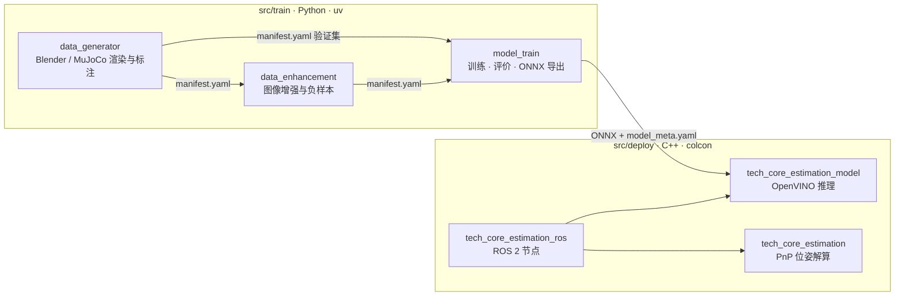

# rm_tech_core_estimation

RoboMaster 2027 科技核心位姿识别的完整方案：仿真生成数据、数据增强、模型训练，以及实车 C++ 部署。输入一帧 RGB 图像和相机标定，输出科技核心在世界系中的位姿。

技术路线：YOLO11n 检测 → LiteHRNet-18 识别 16 个具名关键点 → PnP。达标判据为同一帧平移误差 ≤ 0.01 m 且旋转误差 ≤ 0.0873 rad（见 [model_train 评价协议](src/train/model_train/Readme.md#评价协议)）。目前只有仿真评价，尚无实拍验收。

## 模块与数据流

| 目录 | 职责 | 语言 / 构建 |
|---|---|---|
| [src/train](src/train/Readme.md) | 数据生成、增强、训练、评价，交付 ONNX 模型 | Python 3.12，uv 工作区 |
| [src/deploy](src/deploy/Readme.md) | 模型推理、位姿解算、ROS 2 封装 | C++17，colcon（ament_cmake） |

## 跨模块契约

三份契约是训练端与部署端之间唯一的耦合点。修改其中任何一份，都要同步检查所有使用方。

| 契约 | 持有者 | 内容 | 使用方 |
|---|---|---|---|
| 几何契约 `keypoints.yaml` | [data_generator](src/train/data_generator/Readme.md) | 16 个关键点的名称、顺序、分组及核心系坐标（m），以及 profile 名称 | 所有训练模块；经 `model_meta.yaml` 下发到部署端 |
| 数据集契约 `manifest.yaml` | [data_generator](src/train/data_generator/Readme.md) | 图像、K、真值位姿、关键点像素、可见性、数据划分、来源视角、渲染与增强参数 | data_enhancement、model_train |
| 模型交付契约 ONNX + `model_meta.yaml` | [model_train](src/train/model_train/Readme.md) | 检测与关键点两个 ONNX、预处理参数、冻结门限、几何契约副本及其 SHA-256 | tech_core_estimation_model、tech_core_estimation_ros |

三份契约文件及训练记录统一使用 YAML。几何契约的 SHA-256（几何指纹，对规范化后的内容计算）写入每份 manifest 和每个模型。训练和部署在加载时都会核对指纹，点序或坐标不一致时直接拒绝。

## 已知边界

- 关键点坐标位于模型的名义核心系；模型原点与规则手册 E 点之间尚未进行实物标定。
- 训练数据全部来自仿真，未包含实拍图像或真实镜头畸变。
- 当前仅支持单目标、marker 处于静止初态的情形。

`output/`（数据、权重、评价结果）、`processing/`（任务进度记录）及 `build/`、`install/`、`log/`、`.venv/` 均不纳入版本管理。
